# Image → Prompt Reverse Engineering · Breakdown & Rebuild

[简体中文](README.md) ｜ **English**

> Break a reference image down into its structure, then rebuild that structure with a prompt.
> Four case studies, each with the original, the generated image, and the reverse-engineered prompt.

---

## What this is

This is not a bag of "nice-looking prompts". It is a **deconstructable, reusable, verifiable** method: decide which layers a visual is built from, translate those layers into sentences an image model can execute, then use the output to find out which sentence failed.

All four sets follow one pipeline:

```
reference  →  breakdown (layout / layers / type / sampled colour)  →  prompt (ZH + EN)
           →  generate  →  diff against reference  →  revise  →  final
```

The breakdown is not adjective-stacking. Every ratio, hex value and luminance figure below was **measured** from the source image.

The skill itself also ships here: `skill/shuixian-image-reverse/`, installable as-is — see the next section.

---

## Using the skill inside WorkBuddy

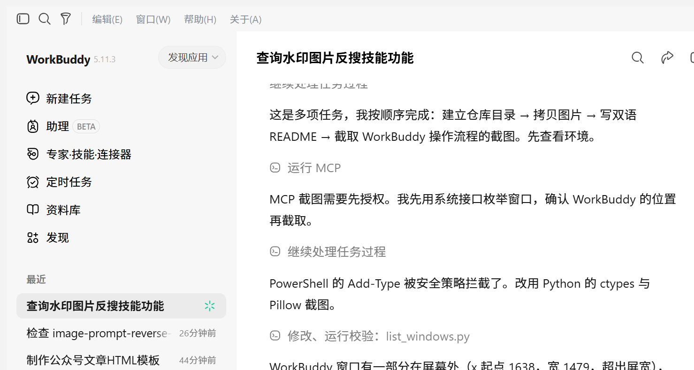

<sub>The WorkBuddy workspace. *Experts · Skills · Connectors* on the left is where the skill is enabled; the chat pane on the right is where the reference image goes.</sub>

### Installation

The skill itself ships in this repository: `skill/shuixian-image-reverse/`. Drop that folder into your skills directory — no build step, no dependencies.

```bash
# macOS / Linux — user level, available in every project
git clone https://github.com/BaYue-SYJ/shuixian-image-reverse.git
mkdir -p ~/.workbuddy/skills
cp -r shuixian-image-reverse/skill/shuixian-image-reverse ~/.workbuddy/skills/
```

```powershell
# Windows — user level
git clone https://github.com/BaYue-SYJ/shuixian-image-reverse.git
New-Item -ItemType Directory -Force "$env:USERPROFILE\.workbuddy\skills" | Out-Null
Copy-Item -Recurse .\shuixian-image-reverse\skill\shuixian-image-reverse "$env:USERPROFILE\.workbuddy\skills\"
```

For a single project, use `<project>/.workbuddy/skills/` instead. Takes effect after the session restarts.

| File | What it does |
|---|---|
| `SKILL.md` | Main flow: intent routing → evidence selection → position quantification → sentence order → self-check → revision from output |
| `references/analysis-framework.md` | 12-axis general image analysis |
| `references/category-guides.md` | Per-category notes for 17 subject and medium types |
| `references/illustration-style.md` | Illustration style: decoupling content from style, style fingerprints |
| `references/tool-targets.md` | Target-tool adaptation: ratio syntax, negative-prompt tiers, language and length |
| `agents/openai.yaml` | Display name and default prompt used inside WorkBuddy / Codex |


| Step | Action |
|---|---|
| 1 | Attach the skill: `@skill:shuixian-image-reverse`, or enable it under *Experts · Skills · Connectors* |
| 2 | Drop the reference image into the chat |
| 3 | State the intent in one line: `reverse this image` / `paint X in this style` / `reuse this poster's layout` |
| 4 | Take the bilingual prompt, generate, then paste the result back to get targeted revisions |

**Why intent comes first:** the opening sentence decides whether the model *copies* or *creates*. A noun phrase (`A 3:2 photo of a warm café.`) reproduces; an imperative (`Design a vertical screen-print poster about the last tram.`) creates. Mixing them is the most common failure mode.

---

## Case 1 · Game poster, new subject

The reference is a 16:9 retro-neon composite: a photographic subject over a painted sunset, with a four-tier text block on the left (stacked wordmark + outlined numeral + two small lines).

| Reference | Generated (male version) |
|---|---|
| 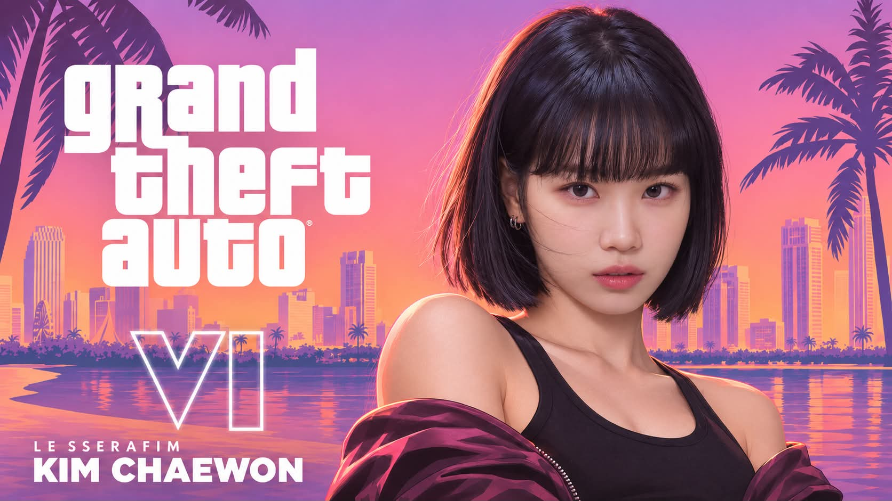 | 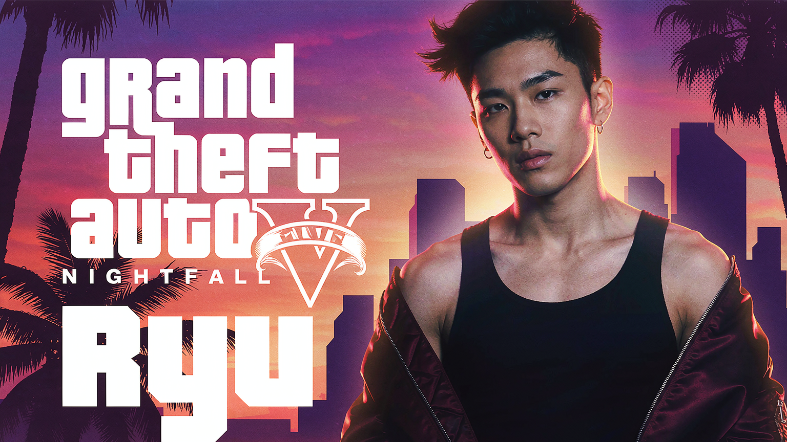 |

**Prompt (English)**

```text
A 16:9 retro-neon composite poster: a photographic man composited over a painted sunset backdrop. He occupies the right half of the frame, from the top of his head to his chest — hair crown about one-fifteenth of the frame height below the top edge, shoulders cut by the bottom edge, his left outline near the vertical centre. He faces the camera: short black hair, tapered at the sides with volume on top, a few strands lifted by wind falling over the forehead, a warm orange rim light along the crown and the right edge of his hair; a clean jawline, no beard. Black wide-strap tank top, a deep burgundy satin bomber slid off both arms so shoulders and collarbones are bare; a thin silver hoop earring on one ear, thin lips, calm expression, direct gaze.

Behind him the sky runs magenta-purple at the top through peach-pink, turning apricot orange at the waterline. A wall of deep-purple rectangular towers spans the full width, standing on the horizon. The lower fifth is pink-lilac water with horizontal ripple bands catching orange light. Dark purple-black palm fronds silhouette in the top-left and top-right corners, tips running off frame, with a thick trunk section at the left.

The left text block covers about two-fifths of the frame width, entirely white: three tightly stacked lines of heavy lowercase sans — grand / theft / auto — flush left, a tiny ® after "auto"; below, an outlined white-line Roman numeral VI; then small letterspaced [GROUP NAME]; at the bottom large bold [NAME].
```

**提示词（中文）**

```text
16:9 横幅的复古霓虹合成海报，真人摄影主体叠在手绘落日背景上。男性占画面右半，从头顶到胸口，发顶距顶边约十五分之一画高，肩线以下被底边裁断，左缘落在画宽中线附近。他正对镜头，黑色短发，两侧推短、头顶留松量，几缕前发被风带起垂在额前，发顶与发丝右缘有一道暖橙轮廓光；下颌线清晰，无胡须；黑色宽肩背心外搭深酒红缎面夹克，夹克褪到两臂外侧，双肩与锁骨裸露；单耳细银圈耳环，薄唇，神情平静直视镜头。

身后天空自上而下由品红紫过渡到桃粉，近水面处转杏橙。深紫色的方柱状高楼群横贯全宽，坐在水平线上缘。画面下五分之一是粉紫水面，横向波纹泛橙光。左上与右上各一簇深紫近黑的棕榈叶剪影，叶尖出画，左侧另露出粗树干一段。

左侧文字区占画宽约五分之二，全部纯白。上方为三行紧排的粗体无衬线小写：grand / theft / auto，左端对齐，auto 右上角一个极小的 ®；其下一枚细白线描的空心罗马数字 VI；再下是小号、字距拉开的 [组合名]；最底为大号粗体 [姓名]。
```

> Only the subject changed; the composition is untouched. `grand theft auto` and the `VI` mark are real trademarks — layout experiment only, not for commercial use.

---

## Case 2 · City identity poster, new city

The reference is a 4:5 city identity poster built on "compressed geography": palace, CBD, mountains and temple forced onto one sight line.

| Breakdown |
|---|
| 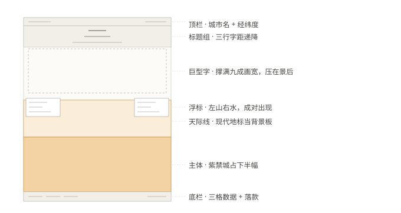 |

Seven zones: top bar (coordinates instead of rules) → title group (three tiers of decreasing tracking) → hollow display word (used as texture) → paired data notes (one natural, one human) → skyline → main subject → bottom data strip.

Sampled colour: warm sand `#E5B794` (11.3%), near-black `#281A11` (11.1%), sky blue `#466684` (8.6%), brick `#633020` (7.6%) — only three axes: cool blue-grey, warm sand, near-black.

| Reference (Beijing) | Generated (Hong Kong, China) |
|---|---|
| 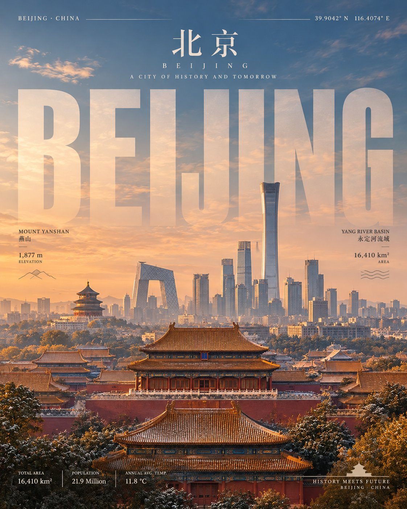 | 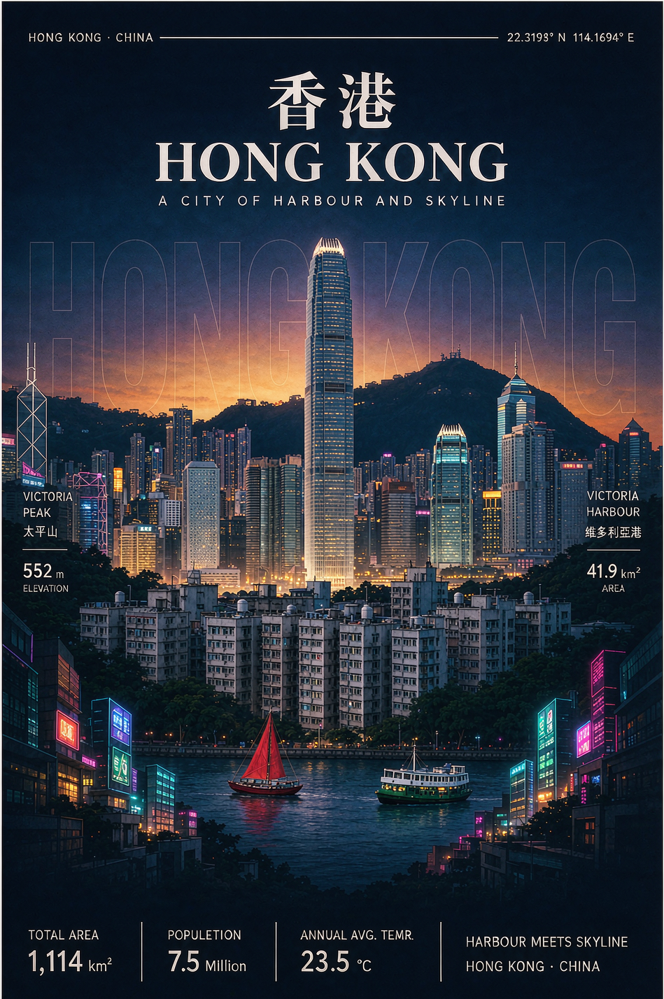 |

**Prompt (English)**

```text
Vertical city identity poster, 4:5 composition centred on a tall 2:3 canvas with generous empty margins above and below the central artwork. Editorial travel poster, photographic city composite over a painted sky, flat print layout.

Top info bar: small letterspaced white sans reading HONG KONG · CHINA at the left, a thin white hairline running right from it across the page; at the far right end of the same hairline, small letterspaced white text reading 22.3193° N 114.1694° E.

Centred title group below the bar: large white Chinese serif characters 香港, then HONG KONG in widely letterspaced white sans capitals beneath, then a much smaller widely letterspaced white line reading A CITY OF HARBOUR AND SKYLINE.

Behind the whole scene, a giant hollow outline display word HONG KONG spanning ninety percent of the poster width, its fill almost identical to the sky behind it so it reads as half transparent, only a hairline outline, with the skyline buildings cutting across the letterforms.

Six depth layers, front to back. Furthest: a blue-hour sky running deep navy at the top through violet, turning amber gold just above the horizon. Next: a ridge of dark hazy mountains across the full width. Then the modern skyline, two supertall towers and a cluster of glass towers on both sides of the water, windows lit warm. Then a dense carpet of low residential blocks and rooftop water tanks. Then Victoria Harbour across the middle of the frame, a red-sailed Chinese junk and a green-and-white ferry crossing it. At the very front, dark neon-signed street facades in the lower corners pressing the edges into shadow, tiny restrained magenta and cyan sign glows.

Left floating data note at mid height on the left edge, white: VICTORIA PEAK, then 太平山 below it, a hairline rule, then 552 m and ELEVATION with a tiny mountain glyph. Right floating data note mirrored on the right edge: VICTORIA HARBOUR, then 維多利亞港 below it, a hairline rule, then 41.9 km² and AREA with a tiny wave glyph.

Bottom data strip, all white: three left-aligned blocks separated by thin vertical rules reading TOTAL AREA 1,114 km², POPULATION 7.5 Million, ANNUAL AVG. TEMP. 23.5 °C; at the right end two lines reading HARBOUR MEETS SKYLINE over HONG KONG · CHINA with a tiny skyline glyph.

Only three colour axes: cool navy blue, warm amber, near black. No saturated colour accents apart from the tiny neon dots. Crisp print edges.
```

**提示词（中文）**

```text
城市名片海报，4:5 竖版构图，落在更高的 2:3 画布上、上下留出宽边距；摄影合成加绘制天空的编辑式旅行海报，平版印刷排布。

顶栏：左端小号、拉开字距的白色无衬线「HONG KONG · CHINA」，一条细白横线向右贯到对侧；横线右端是小号「22.3193° N 114.1694° E」。

标题组居中于顶栏下方：大号白色中文衬线「香港」，其下是大幅拉开字距的白色无衬线大写「HONG KONG」，再下一行更小、更开的白色「A CITY OF HARBOUR AND SKYLINE」。

整幅背景之上，一个巨大的空心描边字「HONG KONG」撑满九成画宽，填充色与背后天空几乎相同、只留发丝般的描边，天际线建筑切过字母。

六层景深由后到前：最深是蓝调时刻的天空，顶端深藏青、中段转紫、近地平线转为琥珀金；其次是一道横贯全宽的暗色雾霭山脊；再是两岸的现代天际线，两座超高层加一片玻璃塔群，窗格透暖光；再是一片低矮住宅楼与屋顶水箱；接着是横过画面中段的维多利亚港，一艘红帆中式帆船和一艘绿白渡轮正在穿越；最前是压在左右下角的暗色霓虹店面，招牌只有极克制的品红与青色微光。

左侧中段浮标（白色）：VICTORIA PEAK、太平山、细分隔线、552 m、ELEVATION，配一枚小山形图标。右侧对称浮标：VICTORIA HARBOUR、維多利亞港、细分隔线、41.9 km²、AREA，配一枚水波图标。

底栏白色：三个左对齐区块用细竖线分隔，依次 TOTAL AREA 1,114 km²、POPULATION 7.5 Million、ANNUAL AVG. TEMP. 23.5 °C；右端两行 HARBOUR MEETS SKYLINE 压在 HONG KONG · CHINA 之上，配一枚小天际线图标。

全图只用三条色轴：冷藏青、暖琥珀、近黑。除了几粒微小霓虹，没有任何饱和色。边缘干脆。
```

> Figures are public: Victoria Peak 552 m, harbour water area ≈ 41.9 km², land area 1,114 km², population ≈ 7.5 M, annual mean 23.5 °C.

---

## Case 3 · Torn-paper collage, new subject

The reference is a 3:4 collage: three torn fragments of the same person at different scales, the main cutout pressing on top, halftone reserved for the secondary fragments only.

| Breakdown |
|---|
| 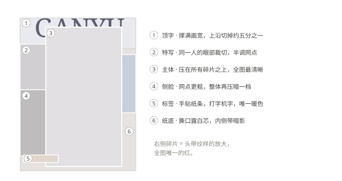 |

Measured: 1086×1448 (3:4); mean saturation 8.1%, mean luminance 181, **84.5% of pixels sit above 160**; display type averages `#5C5E6F`; the only high-saturation note is `#C33751` (headband, saturation 0.72, under 1% of area).

**One-line conclusion:** depth here comes from value contrast, not hue. Halftone is for the secondary fragments; the main cutout stays sharp — the hierarchy is separated by *print quality*, not by blur.

| Reference | Generated A | Generated B |
|---|---|---|
| 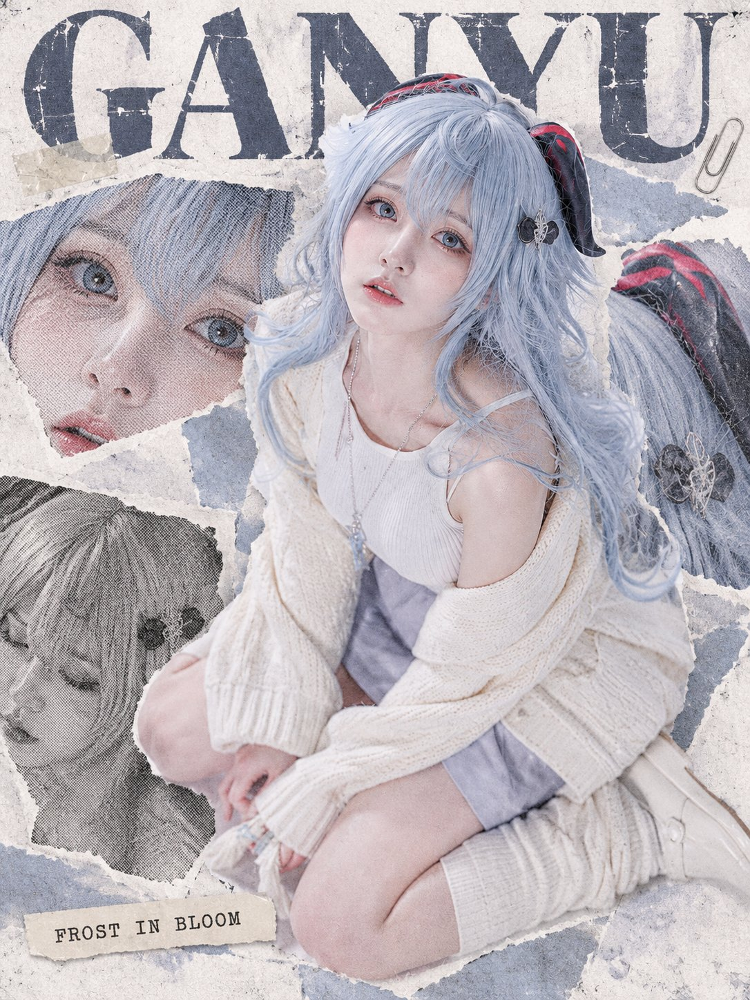 | 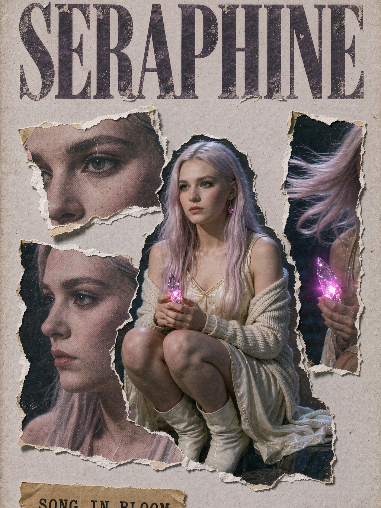 | 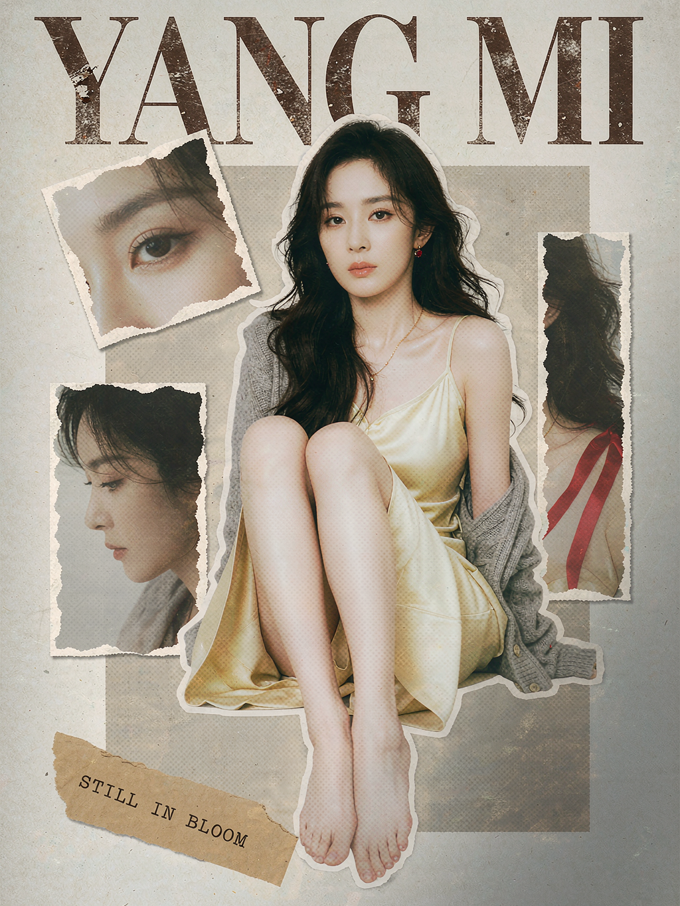 |

**Prompt (English)**

```text
Vertical 3:4 collage poster built from torn paper and coarse halftone print, full bleed, no border. High key and very low saturation across the whole sheet, with one single small crimson accent.

Top of the frame: the name in very condensed heavy serif capitals, spanning about ninety percent of the poster width, upper edge running past the frame so the letter tops are clipped. Letters in deep warm charcoal-brown with worn letterpress ink, chipped edges, broken ink patches, tracking squeezed tight.

Paper base: warm pale grey handmade paper with fine grain, small speckles and a few dirt flecks, slightly yellowed at the edges.

Three torn photographic fragments of the same woman, each with a raw torn edge showing a white paper core plus a thin dark shadow inside the tear, torn in different directions so they read as separate sheets. Upper left: an extreme close crop of one eye and the bridge of her nose, tipped a few degrees, printed in coarse halftone dots. Lower left: a three-quarter profile of her face and jaw, halftone dots coarser still, darkened one stop and desaturated toward grey. Right edge: a tall narrow fragment of long dark hair lifting and a length of red silk ribbon.

Centre, laying over every fragment and pressing ten to twenty pixels into their torn edges: a photographic full-colour cutout of a young East Asian woman seated with her knees drawn up, cropped from head to mid-calf. Long dark brown-black hair with soft loose waves falling past her shoulders, almond-shaped eyes, calm gaze slightly off camera, a small deep red gemstone stud at one ear. She wears a cream silk slip dress with a fine gold chain at the neck, a soft grey knitted cardigan slipping off one shoulder, bare feet. Her figure stays crisp and fully photographic with no halftone on her at all, so print quality alone separates her from the fragments.

A single high-saturation crimson note, no more than one percent of the image: the gemstone at her ear.

Bottom left at about eighty-five percent of the frame height: a strip of torn kraft paper tape carrying the words STILL IN BLOOM in typewriter monospace capitals with slightly uneven ink.

The whole sheet holds a faint photographic paper texture and a low-opacity grain over everything, including the central figure, so the cutout and the paper share one surface.
```

**提示词（中文）**

```text
3:4 竖版的撕纸拼贴海报，满幅出血、无边框。整体高调、极低饱和，只留一处极小的胭脂红。

顶部：一行极窄的重衬线大写名字，撑满约九成画宽，上缘越过画框被切掉；字母为深暖炭褐色，带凸版印刷的磨损、缺墨与断口，字距压紧。

纸底：暖调浅灰手工纸，细颗粒、小斑点与几处脏点，边缘略微泛黄。

三块撕下的照片碎片，同一名女子，撕口一律露出白色纸芯、内侧一道细暗影；三块的撕开方向各不相同，读起来是三张独立的纸。左上：一只眼睛与鼻梁的特写，倾斜几度，粗网点印刷。左下：四分之三侧脸与下颌，网点更粗、压暗一档、往灰里褪。右缘：一条细长的碎片，长发被风带起，一段红丝绸带。

正中，压在所有碎片之上、并压进撕口 10—20 像素：一张全彩的摄影剪影，年轻东亚女性，抱膝坐姿，从头顶裁到小腿中段。深棕黑长发带自然波浪垂过肩，杏眼，目光略偏镜头，单耳一枚深红宝石耳钉。奶油色真丝吊带裙、颈间一根细金链，一件浅灰针织开衫滑落一侧肩，赤足。她保持完全清晰的照片质感，身上没有任何网点——靠印刷质量本身把她和碎片分开。

唯一的高饱和胭脂红，不超过画面百分之一：她耳上那颗宝石。

画面高度约 85% 处，左下：一条撕下的牛皮纸胶带，打字机等宽大写 STILL IN BLOOM，墨色不匀。

整张纸带一层淡淡相纸纹理与低透明度颗粒，覆盖包括中央人物在内的全部区域，让剪影和纸面共享同一个表面。
```

> Both generations share one skeleton; only the subject paragraph and the display name change. Known defects: torn edges render as even "sticker outlines" instead of paper fibre; an extra hard-edged translucent backing sheet appears behind the main cutout.

---

## Case 4 · White model, new building

The reference is a **1080×864 (5:4)** photograph of a white scale model, with a single gilded hall.

| Breakdown |
|---|
| 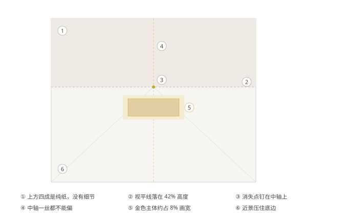 |

Measured: mean luminance **224.1**, **90% of pixels inside a 32-level band (208–239)**, and no true black anywhere — the darkest pixel is `#805B15`, which is gold, not grey. Form is carried entirely by ambient occlusion, which is why the material must be matte and highlight-free.

| Reference (Forbidden City) | Generated (White House) |
|---|---|
| 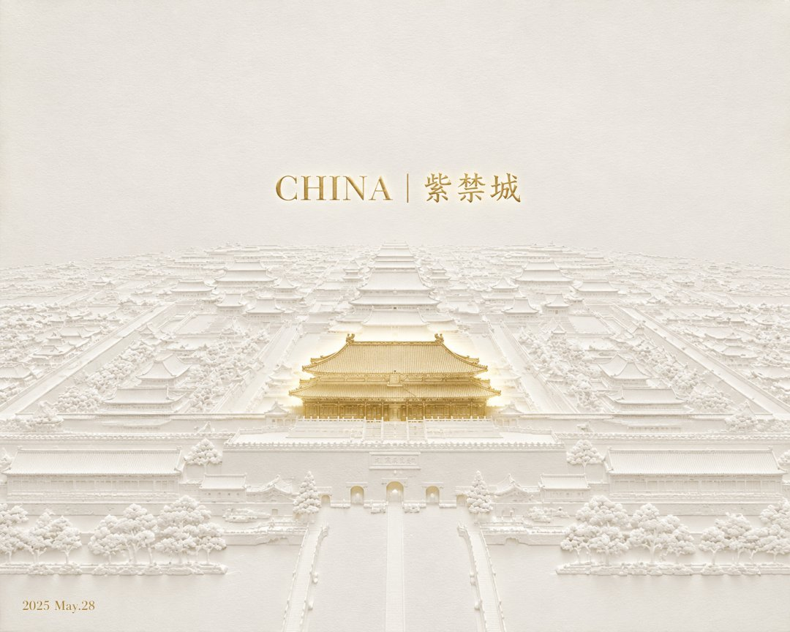 | 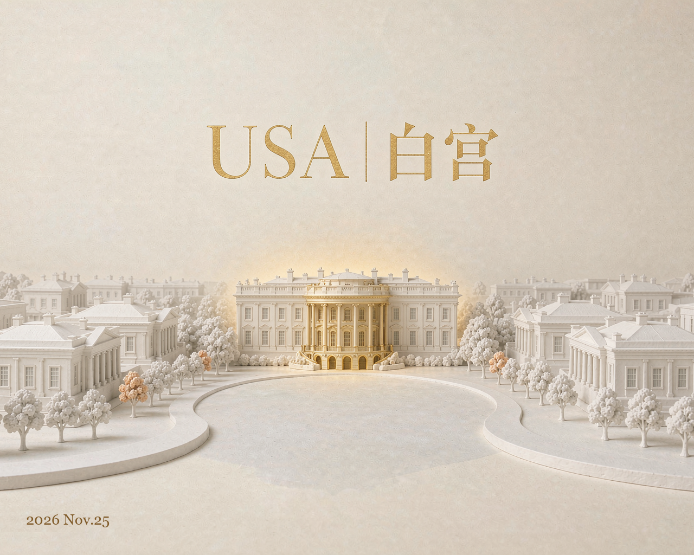 |

**Prompt (English)**

```text
Architectural model photograph, poster layout, 5:4 landscape composition whose key content stays inside the central eighty percent of the frame width. A white plaster scale model of the White House complex and its grounds, seen from an elevated bird's-eye viewpoint to the south, looking north straight along the main axis. Perfect left-right symmetry, strict one-point perspective, all the roof lines and driveway edges converging on the central axis.

Medium: matte white unglazed plaster and paper, completely diffuse, no specular highlights anywhere, no reflections. All form is described only by soft ambient occlusion in the roof creases, wall joints and between the trees, in a narrow band of greys. Warm off-white seamless paper backdrop, fine grain, faint vignette at the corners.

The upper forty percent of the frame is blank paper with no detail at all, empty sky fading to pure white. The horizon line sits at about forty-two percent of the frame height, where the far grounds dissolve into the paper. In the near foreground the white South Lawn and its curved drive press against the bottom edge, with rows of small model trees along both sides tipped with the faintest warm cast.

Exactly one element carries colour: the main residence block, centred on the axis just below the horizon, rendered in warm gold leaf and occupying about eight percent of the frame width, its colonnade and cornice picked out in brighter gold. It is surrounded by a soft pale gold glow, a halo rather than a light source. Every other structure stays in plain matte white plaster, distinguished from the paper only by ambient occlusion.

Typography, all in warm gold: centred on the vertical axis at about twenty-nine percent of the frame height, the line USA in spaced thin serif capitals, a thin vertical rule, then the Chinese characters 白宫 in a serif face, both the Latin and the Chinese at the same optical size. At the very bottom left, far smaller and paler, the date in the same serif.

No black anywhere in the image, no saturated colour other than the gold, no people, no vehicles, no flags, no lettering on the buildings. Everything reads as one continuous paper surface with a low-opacity grain over the whole sheet.
```

**提示词（中文）**

```text
建筑模型摄影，海报版式，5:4 横版构图，关键内容留在画宽中央八成之内。白色石膏比例的总统府建筑群与场地，从南侧上方俯视，沿主轴向北平视。完美的左右对称，严格的一点透视，所有屋脊线与车道边线交于中轴。

媒介：哑光白石膏与纸，完全漫反射，没有任何镜面高光与反射。所有形体只由屋脊折缝、墙缝、树丛之间柔和的环境光遮蔽来交代，落在一个很窄的灰阶带里。暖白无缝纸背景，细颗粒，四角轻微暗角。

画面上方四成是完全没有细节的空白纸，天空向纯白褪去。视平线在画高约 42%，远处场地化进纸里。前景的白色南草坪与弧形车道压住底边，两侧成排的小树梢带一丝极淡的暖调。

恰好只有一个元素带颜色：总统府主楼，居轴线、位于视平线略下方，做暖金箔，约占画宽百分之八，柱廊与檐口用更亮的金勾出。它周围围着一圈柔和的浅金光晕，是光晕而不是光源。其余所有结构——两翼、柱廊、附属建筑、远处偏左的古典办公楼、右侧的长柱廊建筑——一律哑光白石膏，只靠环境光遮蔽与纸面区分。

文字，全部暖金：居中于垂直轴、约画高 29% 处，一行拉开字距的细衬线大写 USA，一道细竖线，然后是衬线体的中文「白宫」，拉丁与中文视觉字号相同。画面左下角，更小更淡，同款衬线：2026 Nov.25。

全图没有黑色，除金色外没有饱和色，没有人物、车辆、旗帜，建筑上没有文字。整体读作一张连续的纸面，全幅覆一层低透明度颗粒。
```

> Deviations in the result: the gilded block covers ~14% of the width (reference: 8%), the horizon sits at ~48% (reference: 42%), and the gold colonnade picks up a slight specular sheen. All three erode the restraint.

---

## Method

### 1. Decide what is being reproduced

| Intent | What goes into the prompt | Opening form |
|---|---|---|
| Reproduce the whole image | subject, medium, and the relationships that make it recognisable | noun phrase |
| Borrow the style | new subject; strip props and narrative belonging to the original subject | imperative |
| Borrow the layout | map aspect, proportions, crop, orientation, occlusion, negative space and type areas onto a new subject | imperative |

### 2. Quantify position

Models read "roughly centre, slightly left" as *enlarge until it fills*, which pushes edge elements out of frame. Use fractions of the frame width or height, and write `all four edges visible` for anything that must not be cropped. Quantify one to three elements only.

### 3. Sentence order

```
1. aspect ratio and orientation, medium
2. subject, position, proportion, and the occlusion between subjects
3. material, colour, where detail concentrates
4. light direction and where it lands
5. background, negative space, atmospheric depth
6. type: exact copy, letterforms, line breaks, position
```

Baseline length: 150–250 characters/words depending on language. Minimal scenes reach ~80; multi-subject layouts with per-element placement reach ~350.

### 4. Pre-delivery checklist

1. ZH and EN lines correspond — nothing added or dropped
2. Visual anchors sit at the start and are *visible features*, not style labels
3. No "as shown in the image" that breaks without the reference
4. No invented focal length, aperture, camera, software, place name or brand
5. Every element at risk of cropping has a quantified position
6. Length inside the range, adjectives cut to the bone

---

## After generation

Image endpoints have fixed sizes, so cropping is usually part of the job:

| Target ratio | Approach |
|---|---|
| 16:9 | generate 1536×1024, cut 160px from the bottom (removes the AI watermark too) |
| 5:4 | generate 1536×1024, cut 128px from each side (keeps axial symmetry) |
| 3:4 | generate 1024×1536, cut the bottom at the watermark edge and take the remainder off the top |

Always zoom into the corners before cutting. Locating a watermark by brightness threshold over a large region will also select white credit text and erase it by mistake — that happened once while making Case 2.

---

## Boundaries and licensing

- **Real people:** publicly known figures are described only by visible appearance, in neutral scenes. No identity inference, no fabricated statements or intimate, violent or political contexts. Commercial use requires a separate likeness licence.
- **Characters and brands:** the `grand theft auto` wordmark, the `VI` mark and game character designs belong to their owners. This repository demonstrates layout and method only, and grants no rights.
- **Buildings:** architectural works are generally not protected by copyright in most jurisdictions, but photographs of them are. Use your own or openly licensed source material.
- **When it cannot be done:** if the image is too small to read, if the request is transcription, or if it is really an edit rather than a regeneration — say so instead of forcing a prompt.

---

## Repository layout

```
.
├── README.md                  # 简体中文
├── README.en.md               # this file
├── skill/
│   └── shuixian-image-reverse/    # the skill itself, copy into .workbuddy/skills/
│       ├── SKILL.md
│       ├── agents/openai.yaml
│       └── references/            # four reference modules
├── assets/
│   ├── 01-gta6/               # game poster, new subject
│   ├── 02-city/               # city identity, new city
│   ├── 03-collage/            # torn-paper collage, new subject
│   └── 04-model/              # white model, new building
└── docs/
    ├── 01-workbuddy-window.png
    └── diagrams/              # breakdown diagrams (SVG, lossless scaling)
        ├── city-zones.svg
        ├── collage-layers.svg
        └── model-perspective.svg
```

---

## About the images

- Reference images come from public sources and are used for method demonstration only; they will be removed on request by the rights holder.
- Generated images are produced by AI models. They are **not photographs** and do not represent any brand, person or institution.
- All cropping and watermark removal was done locally without altering the source files.

---

<p align="center"><sub>Made with the <code>shuixian-image-reverse</code> skill in WorkBuddy</sub></p>
