# 图片反推提示词 · 拆解与复现

**简体中文** ｜ [English](README.en.md)

> 从一张参考图拆出它的结构，再用提示词把结构重新生成出来。  
> 四个案例，每个都放了原图、生成图，和对应的反推提示词。


---

## 这是什么

这不是一堆"好看的提示词"，而是一套**可拆解、可复用、可验证**的方法：先判断视觉结构由哪几层组成，再把结构翻译成生图工具能执行的句子，最后用生成结果反查哪句话没起作用。

仓库里的四组图都遵循同一个流程：
```
参考图  →  拆解（版式 / 图层 / 字体 / 色彩采样）  →  反推提示词（中英双语）
        →  生成  →  对照参考图找偏差  →  修词  →  成品
```

拆解不靠形容词堆砌。每个案例里的分区比例、色值、明度分布都是从原图**实测**出来的，不是估的。

技能本体也在这个仓库里：`skill/shuixian-image-reverse/`，可直接安装使用，见下一节。

---

## 在 WorkBuddy 里怎么用这个 Skill

### 安装

**方式一 · 技能市场**

打开 WorkBuddy 左侧栏「专家·技能·连接器」→「技能」页，搜索「水仙的图片反推」，点卡片右侧的「+」即可。这页默认只展示未安装的技能，装好之后卡片会移到上方「已安装」里。

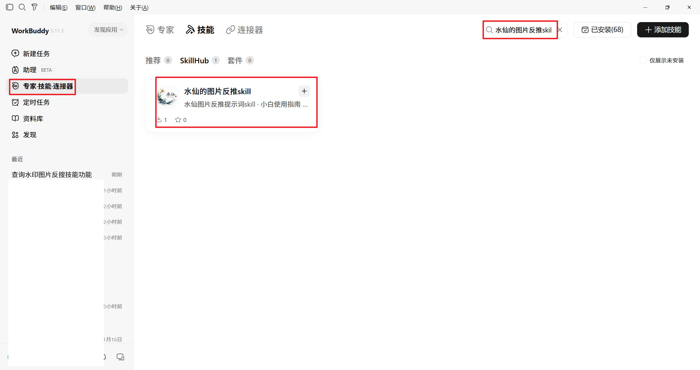

**方式二 · 从仓库复制**

技能本体就在本仓库里：`skill/shuixian-image-reverse/`。整个目录丢进技能文件夹即可，不需要构建、没有依赖。

```bash
# macOS / Linux —— 用户级，所有项目可用
git clone https://github.com/BaYue-SYJ/shuixian-image-reverse.git
mkdir -p ~/.workbuddy/skills
cp -r shuixian-image-reverse/skill/shuixian-image-reverse ~/.workbuddy/skills/
```

```powershell
# Windows —— 用户级
git clone https://github.com/BaYue-SYJ/shuixian-image-reverse.git
New-Item -ItemType Directory -Force "$env:USERPROFILE\.workbuddy\skills" | Out-Null
Copy-Item -Recurse .\shuixian-image-reverse\skill\shuixian-image-reverse "$env:USERPROFILE\.workbuddy\skills\"
```

只想在单个项目里用，就放到 `<项目>/.workbuddy/skills/`，效果相同。重启会话后生效。

**技能构成**

| 文件 | 作用 |
|---|---|
| `SKILL.md` | 主流程：意图判断 → 证据选取 → 量化位置 → 六句序写作 → 交付自查 → 按成图修词 |
| `references/analysis-framework.md` | 12 维通用图片分析框架 |
| `references/category-guides.md` | 17 类主体与媒介的专项拆解要点 |
| `references/illustration-style.md` | 插画画风专项：内容与画风解耦、画风指纹 |
| `references/tool-targets.md` | 目标工具适配：比例写法、负面词三分法、语言与篇幅 |
| `agents/openai.yaml` | 在 WorkBuddy / Codex 中显示的技能名与默认提示语 |


### 第一步 · 确认技能已启用

左栏点「专家·技能·连接器」，进入「已安装技能」。在「用户自定义」分区里找到 `shuixian-image-reverse`，确认卡片右侧的开关是开启状态。卡片上那句灰色描述就是技能的 `description`，用来快速判断它是不是你要的那个。

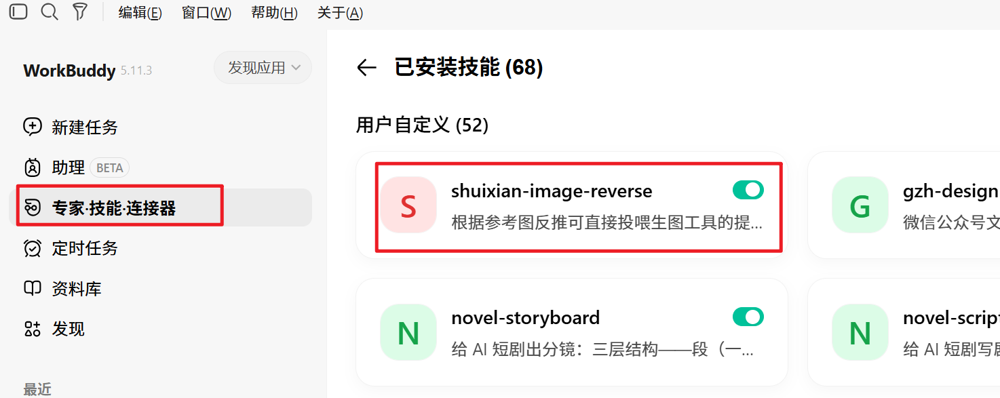

<sub>WorkBuddy 5.11.3 的「已安装技能」页面。分组名称与计数（如「用户自定义 (52)」）随各自安装情况变化，不必对数字。</sub>

列表里没有它，说明还没装好：回到上一节，把 `skill/shuixian-image-reverse/` 放进技能目录后重启会话。

### 第二步 · 点开卡片核对内容

点卡片进入详情页。「概述」里显示的就是 `SKILL.md` 全文——名称、描述，以及「确定要复现什么」那张意图对照表都在里面。装完先对一眼，确认读到的是当前版本，而不是旧的缓存。

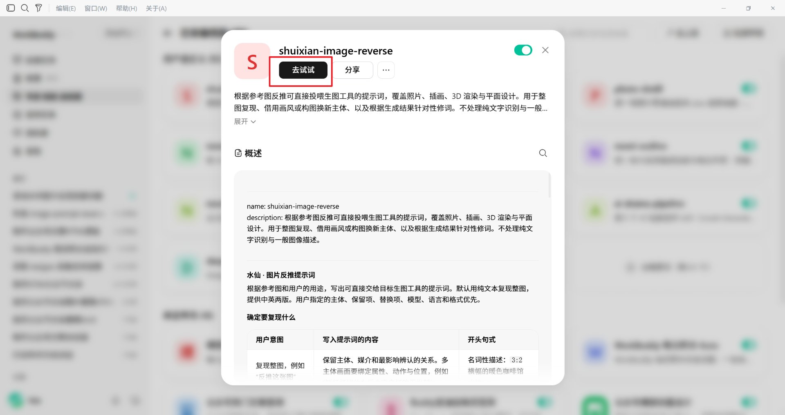

<sub>详情页右上角三个入口：「去试试」「分享」「⋯」。</sub>

### 第三步 · 进对话，给图和意图

点「去试试」开始试用；已经在对话里的话，用 `@skill:shuixian-image-reverse` 挂载。然后把参考图拖进来，用一句话说清要做什么——这一句决定走哪条分支。

| 你说什么 | 技能走哪条分支 |
|---|---|
| `反推这张图` | 复现整图 |
| `用这个风格画一间早餐店` | 借画风 |
| `沿用这张海报的布局，换成海贝` | 借构图 |

### 第四步 · 拿提示词去生图，再把结果贴回来

输出是中英双语正向词，可直接复制去生图。生成之后把成图和参考图一起贴回对话，技能会定位最影响结果的一两处偏差，给出可直接重用的修订词，而不是把整段重写一遍。

**为什么要先说意图**：开头句式决定模型是"照抄一张图"还是"创作一张图"。名词句（`3:2 横幅的咖啡馆实拍。`）会让模型复现，祈使句（`设计一张……主题的海报。`）会让模型创作。混用是这类提示词最常见的失效原因。

---

## 四个案例

### 案例 1 · 游戏海报换主体

参考图是一张 16:9 的复古霓虹合成海报：真人摄影主体叠在手绘落日背景上，左侧四层文字块（三行堆叠字标 + 空心罗马数字 + 两行小字）。

<details>

<summary>拆解要点（点击展开）</summary>

- 五个视觉锚点：混合媒介、右半人物、品红→桃粉→杏橙三段天空、下五分之一水面横纹、左侧纯白文字块
- 人物占右半，发顶距顶边约 1/15 画高，肩线以下被底边裁断
- 唯一需要量化的贴边元素：人物左缘落在画宽中线附近
- 文字区占画宽 2/5，四层结构：`grand/theft/auto` → `VI` → 组合名 → 姓名

</details>

| 参考图                                                  | 生成（男版）                                                         |
| ---------------------------------------------------- | -------------------------------------------------------------- |
| 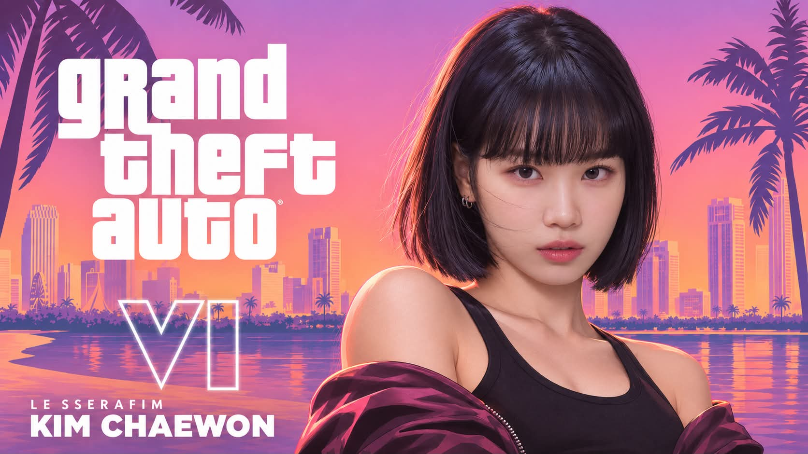 | 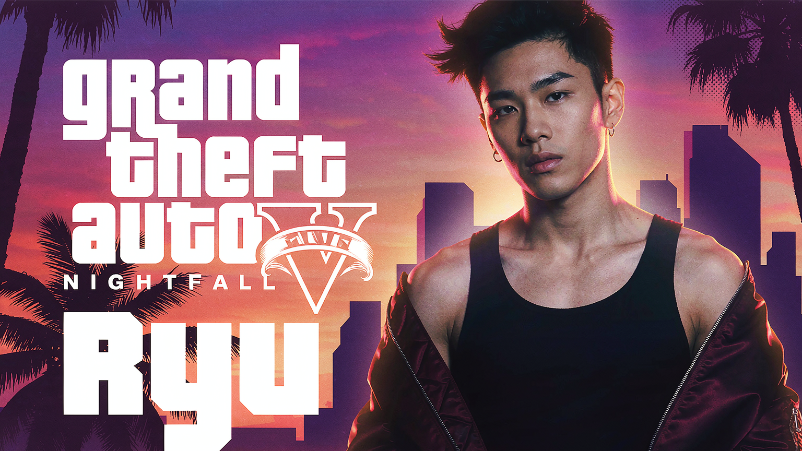 |

**反推提示词（中文）**

```text
16:9 横幅的复古霓虹合成海报，真人摄影主体叠在手绘落日背景上。男性占画面右半，从头顶到胸口，发顶距顶边约十五分之一画高，肩线以下被底边裁断，左缘落在画宽中线附近。他正对镜头，黑色短发，两侧推短、头顶留松量，几缕前发被风带起垂在额前，发顶与发丝右缘有一道暖橙轮廓光；下颌线清晰，无胡须；黑色宽肩背心外搭深酒红缎面夹克，夹克褪到两臂外侧，双肩与锁骨裸露；单耳细银圈耳环，薄唇，神情平静直视镜头。

身后天空自上而下由品红紫过渡到桃粉，近水面处转杏橙。深紫色的方柱状高楼群横贯全宽，坐在水平线上缘。画面下五分之一是粉紫水面，横向波纹泛橙光。左上与右上各一簇深紫近黑的棕榈叶剪影，叶尖出画，左侧另露出粗树干一段。

左侧文字区占画宽约五分之二，全部纯白。上方为三行紧排的粗体无衬线小写：grand / theft / auto，左端对齐，auto 右上角一个极小的 ®；其下一枚细白线描的空心罗马数字 VI；再下是小号、字距拉开的 [组合名]；最底为大号粗体 [姓名]。
```

**Prompt (English)**

```text
A 16:9 retro-neon composite poster: a photographic man composited over a painted sunset backdrop. He occupies the right half of the frame, from the top of his head to his chest — hair crown about one-fifteenth of the frame height below the top edge, shoulders cut by the bottom edge, his left outline near the vertical centre. He faces the camera: short black hair, tapered at the sides with volume on top, a few strands lifted by wind falling over the forehead, a warm orange rim light along the crown and the right edge of his hair; a clean jawline, no beard. Black wide-strap tank top, a deep burgundy satin bomber slid off both arms so shoulders and collarbones are bare; a thin silver hoop earring on one ear, thin lips, calm expression, direct gaze.

Behind him the sky runs magenta-purple at the top through peach-pink, turning apricot orange at the waterline. A wall of deep-purple rectangular towers spans the full width, standing on the horizon. The lower fifth is pink-lilac water with horizontal ripple bands catching orange light. Dark purple-black palm fronds silhouette in the top-left and top-right corners, tips running off frame, with a thick trunk section at the left.

The left text block covers about two-fifths of the frame width, entirely white: three tightly stacked lines of heavy lowercase sans — grand / theft / auto — flush left, a tiny ® after "auto"; below, an outlined white-line Roman numeral VI; then small letterspaced [GROUP NAME]; at the bottom large bold [NAME].
```

> 这次只换主体，构图零改动。`grand theft auto` 与 `VI` 是真实商标字形，仅作版式实验，不要商用。

---

### 案例 2 · 城市名片换城市

参考图是一张 4:5 的城市名片海报，走"压缩地理"语法：宫殿、CBD、燕山、天坛被塞进同一条视线。

| 拆解结构                                                 |   |
| ---------------------------------------------------- | - |
| 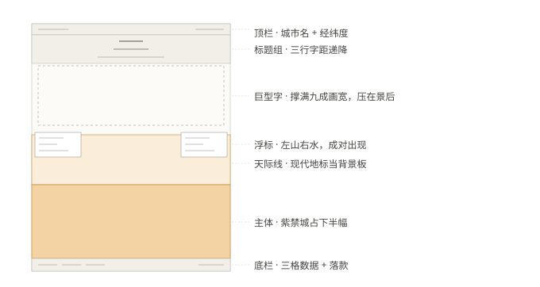 |   |

**七个分区**：顶栏（经纬度代装饰线）→ 标题组（三行字距递降）→ 空心巨型字（当纹理用）→ 左右成对数据浮标（一自然一人文）→ 天际线 → 主体 → 底栏三联数据。

实测色值：暖沙 `#E5B794` (11.3%)、近黑 `#281A11` (11.1%)、天蓝 `#466684` (8.6%)、砖红 `#633020` (7.6%)，全图只有冷蓝灰 / 暖砂橙 / 近黑三条色轴。

| 参考图（北京）                                              | 生成（中国香港）                                                      |
| ---------------------------------------------------- | ------------------------------------------------------------- |
| 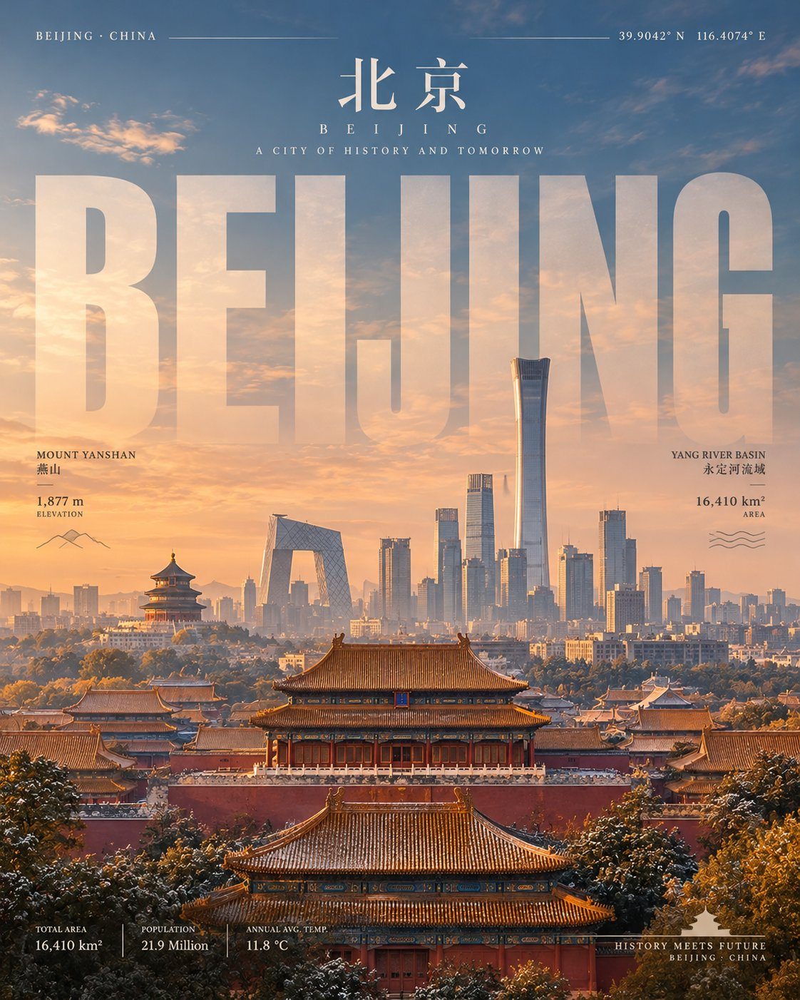 | 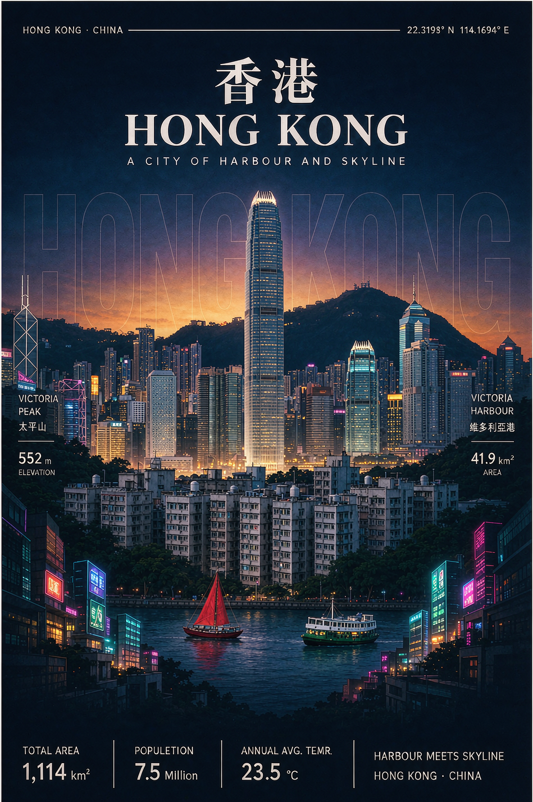 |

**反推提示词（中文）**

```text
城市名片海报，4:5 竖版构图，落在更高的 2:3 画布上、上下留出宽边距；摄影合成加绘制天空的编辑式旅行海报，平版印刷排布。

顶栏：左端小号、拉开字距的白色无衬线「HONG KONG · CHINA」，一条细白横线向右贯到对侧；横线右端是小号「22.3193° N 114.1694° E」。

标题组居中于顶栏下方：大号白色中文衬线「香港」，其下是大幅拉开字距的白色无衬线大写「HONG KONG」，再下一行更小、更开的白色「A CITY OF HARBOUR AND SKYLINE」。

整幅背景之上，一个巨大的空心描边字「HONG KONG」撑满九成画宽，填充色与背后天空几乎相同、只留发丝般的描边，天际线建筑切过字母。

六层景深由后到前：最深是蓝调时刻的天空，顶端深藏青、中段转紫、近地平线转为琥珀金；其次是一道横贯全宽的暗色雾霭山脊；再是两岸的现代天际线，两座超高层加一片玻璃塔群，窗格透暖光；再是一片低矮住宅楼与屋顶水箱；接着是横过画面中段的维多利亚港，一艘红帆中式帆船和一艘绿白渡轮正在穿越；最前是压在左右下角的暗色霓虹店面，招牌只有极克制的品红与青色微光。

左侧中段浮标（白色）：VICTORIA PEAK、太平山、细分隔线、552 m、ELEVATION，配一枚小山形图标。右侧对称浮标：VICTORIA HARBOUR、維多利亞港、细分隔线、41.9 km²、AREA，配一枚水波图标。

底栏白色：三个左对齐区块用细竖线分隔，依次 TOTAL AREA 1,114 km²、POPULATION 7.5 Million、ANNUAL AVG. TEMP. 23.5 °C；右端两行 HARBOUR MEETS SKYLINE 压在 HONG KONG · CHINA 之上，配一枚小天际线图标。

全图只用三条色轴：冷藏青、暖琥珀、近黑。除了几粒微小霓虹，没有任何饱和色。边缘干脆。
```

**Prompt (English)**

```text
Vertical city identity poster, 4:5 composition centred on a tall 2:3 canvas with generous empty margins above and below the central artwork. Editorial travel poster, photographic city composite over a painted sky, flat print layout.

Top info bar: small letterspaced white sans reading HONG KONG · CHINA at the left, a thin white hairline running right from it across the page; at the far right end of the same hairline, small letterspaced white text reading 22.3193° N 114.1694° E.

Centred title group below the bar: large white Chinese serif characters 香港, then HONG KONG in widely letterspaced white sans capitals beneath, then a much smaller widely letterspaced white line reading A CITY OF HARBOUR AND SKYLINE.

Behind the whole scene, a giant hollow outline display word HONG KONG spanning ninety percent of the poster width, its fill almost identical to the sky behind it so it reads as half transparent, only a hairline outline, with the skyline buildings cutting across the letterforms.

Six depth layers, front to back. Furthest: a blue-hour sky running deep navy at the top through violet, turning amber gold just above the horizon. Next: a ridge of dark hazy mountains across the full width. Then the modern skyline, two supertall towers and a cluster of glass towers on both sides of the water, windows lit warm. Then a dense carpet of low residential blocks and rooftop water tanks. Then Victoria Harbour across the middle of the frame, a red-sailed Chinese junk and a green-and-white ferry crossing it. At the very front, dark neon-signed street facades in the lower corners pressing the edges into shadow, tiny restrained magenta and cyan sign glows.

Left floating data note at mid height on the left edge, white: VICTORIA PEAK, then 太平山 below it, a hairline rule, then 552 m and ELEVATION with a tiny mountain glyph. Right floating data note mirrored on the right edge: VICTORIA HARBOUR, then 維多利亞港 below it, a hairline rule, then 41.9 km² and AREA with a tiny wave glyph.

Bottom data strip, all white: three left-aligned blocks separated by thin vertical rules reading TOTAL AREA 1,114 km², POPULATION 7.5 Million, ANNUAL AVG. TEMP. 23.5 °C; at the right end two lines reading HARBOUR MEETS SKYLINE over HONG KONG · CHINA with a tiny skyline glyph.

Only three colour axes: cool navy blue, warm amber, near black. No saturated colour accents apart from the tiny neon dots. Crisp print edges.
```

> 数据均为公开资料：太平山 552 m、维港水域约 41.9 km²、土地面积 1,114 km²、人口约 750 万、年均温 23.5 °C。

---

### 案例 3 · 撕纸拼贴换人物

参考图是 3:4 的撕纸拼贴海报：三块同人物不同尺度的照片碎片各自撕边，主图压在最上；半调网点只给配角。

| 拆解结构                                                     |   |
| -------------------------------------------------------- | - |
| 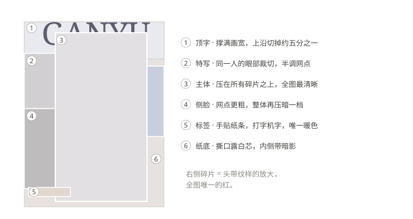 |   |

实测：1086×1448（3:4）；平均饱和度 8.1%、平均明度 181，**84.5% 的像素落在明度 160 以上**；顶字笔画均色 `#5C5E6F`；全图唯一高饱和色 `#C33751`（头带，饱和度 0.72，面积不足 1%）。

**一句话结论**：这张图靠明度差造层次，不靠色相差。半调只给配角、主图保持清晰——层级是用"印刷质量"分开的，不是用模糊。

| 参考图                                                     | 生成 A（游戏角色）                                                        | 生成 B（真人肖像）                                                     |
| ------------------------------------------------------- | ----------------------------------------------------------------- | -------------------------------------------------------------- |
| 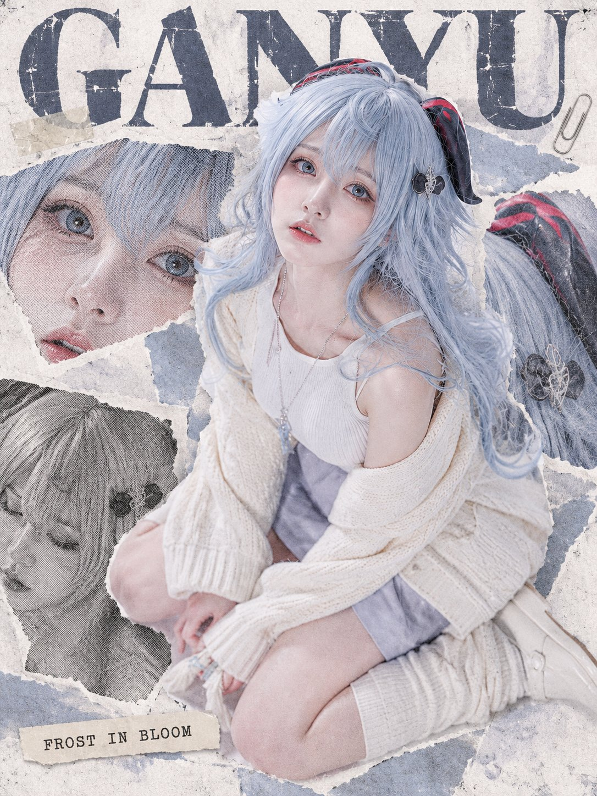 | 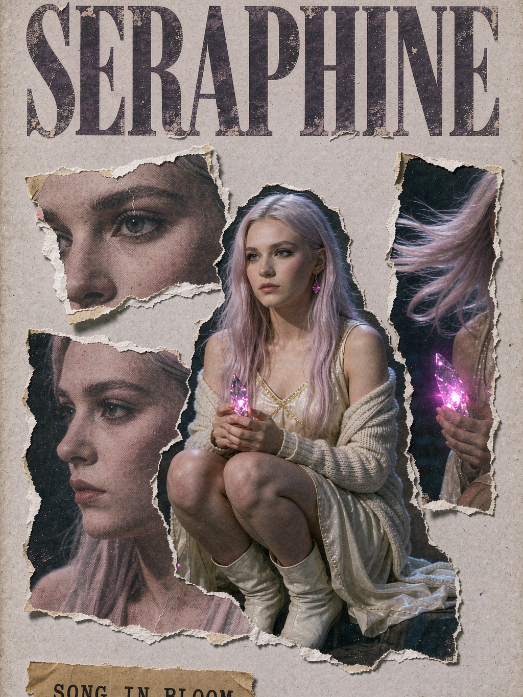 | 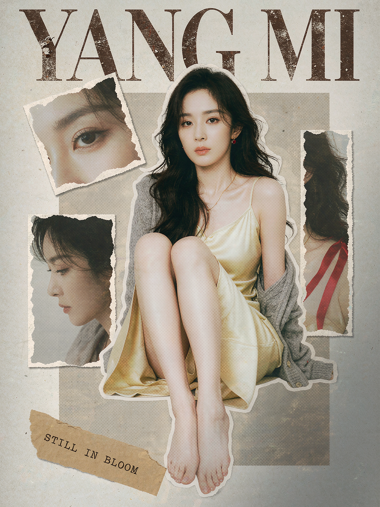 |

**反推提示词（中文）**

```text
3:4 竖版的撕纸拼贴海报，满幅出血、无边框。整体高调、极低饱和，只留一处极小的胭脂红。

顶部：一行极窄的重衬线大写名字，撑满约九成画宽，上缘越过画框被切掉；字母为深暖炭褐色，带凸版印刷的磨损、缺墨与断口，字距压紧。

纸底：暖调浅灰手工纸，细颗粒、小斑点与几处脏点，边缘略微泛黄。

三块撕下的照片碎片，同一名女子，撕口一律露出白色纸芯、内侧一道细暗影；三块的撕开方向各不相同，读起来是三张独立的纸。左上：一只眼睛与鼻梁的特写，倾斜几度，粗网点印刷。左下：四分之三侧脸与下颌，网点更粗、压暗一档、往灰里褪。右缘：一条细长的碎片，长发被风带起，一段红丝绸带。

正中，压在所有碎片之上、并压进撕口 10—20 像素：一张全彩的摄影剪影，年轻东亚女性，抱膝坐姿，从头顶裁到小腿中段。深棕黑长发带自然波浪垂过肩，杏眼，目光略偏镜头，单耳一枚深红宝石耳钉。奶油色真丝吊带裙、颈间一根细金链，一件浅灰针织开衫滑落一侧肩，赤足。她保持完全清晰的照片质感，身上没有任何网点——靠印刷质量本身把她和碎片分开。

唯一的高饱和胭脂红，不超过画面百分之一：她耳上那颗宝石。

画面高度约 85% 处，左下：一条撕下的牛皮纸胶带，打字机等宽大写 STILL IN BLOOM，墨色不匀。

整张纸带一层淡淡相纸纹理与低透明度颗粒，覆盖包括中央人物在内的全部区域，让剪影和纸面共享同一个表面。
```

**Prompt (English)**

```text
Vertical 3:4 collage poster built from torn paper and coarse halftone print, full bleed, no border. High key and very low saturation across the whole sheet, with one single small crimson accent.

Top of the frame: the name in very condensed heavy serif capitals, spanning about ninety percent of the poster width, upper edge running past the frame so the letter tops are clipped. Letters in deep warm charcoal-brown with worn letterpress ink, chipped edges, broken ink patches, tracking squeezed tight.

Paper base: warm pale grey handmade paper with fine grain, small speckles and a few dirt flecks, slightly yellowed at the edges.

Three torn photographic fragments of the same woman, each with a raw torn edge showing a white paper core plus a thin dark shadow inside the tear, torn in different directions so they read as separate sheets. Upper left: an extreme close crop of one eye and the bridge of her nose, tipped a few degrees, printed in coarse halftone dots. Lower left: a three-quarter profile of her face and jaw, halftone dots coarser still, darkened one stop and desaturated toward grey. Right edge: a tall narrow fragment of long dark hair lifting and a length of red silk ribbon.

Centre, laying over every fragment and pressing ten to twenty pixels into their torn edges: a photographic full-colour cutout of a young East Asian woman seated with her knees drawn up, cropped from head to mid-calf. Long dark brown-black hair with soft loose waves falling past her shoulders, almond-shaped eyes, calm gaze slightly off camera, a small deep red gemstone stud at one ear. She wears a cream silk slip dress with a fine gold chain at the neck, a soft grey knitted cardigan slipping off one shoulder, bare feet. Her figure stays crisp and fully photographic with no halftone on her at all, so print quality alone separates her from the fragments.

A single high-saturation crimson note, no more than one percent of the image: the gemstone at her ear.

Bottom left at about eighty-five percent of the frame height: a strip of torn kraft paper tape carrying the words STILL IN BLOOM in typewriter monospace capitals with slightly uneven ink.

The whole sheet holds a faint photographic paper texture and a low-opacity grain over everything, including the central figure, so the cutout and the paper share one surface.
```


> 生成 A（游戏角色版）与 B（真人版）共用同一段提示词骨架，只替换主体段与顶部字标。A 的问题：撕边被画成均匀的"贴纸白边"、主图后多出一块硬边半透明衬纸；B 修正了主体质感，但撕口仍未达到参考图的纸纤维毛边。

---

### 案例 4 · 白模建筑换建筑

参考图是 **1080×864（5:4）** 的白色微缩模型摄影，只有一座殿贴金。

| 拆解结构 | |
|---|---|
| 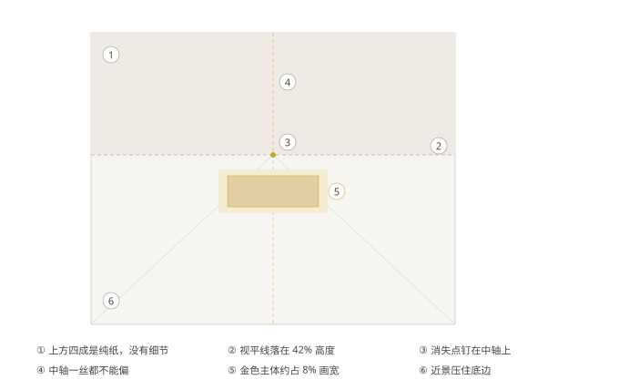 | |

实测：平均明度 **224.1**，**九成像素落在 208—239 这 32 级里**，全图没有一个黑点——最暗的像素是 `#805B15`，属于金色，不是灰色。造形全靠环境光遮蔽（AO），所以材质必须是哑光无高光的白模。

| 参考图（紫禁城） | 生成（白宫） |
|---|---|
| 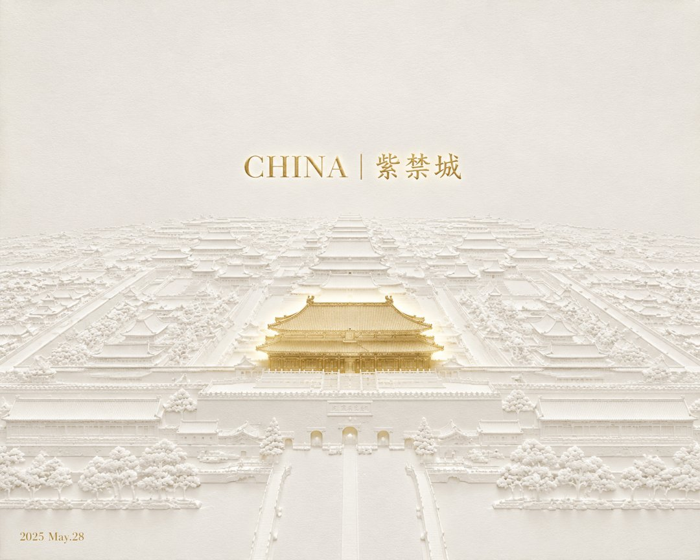 | 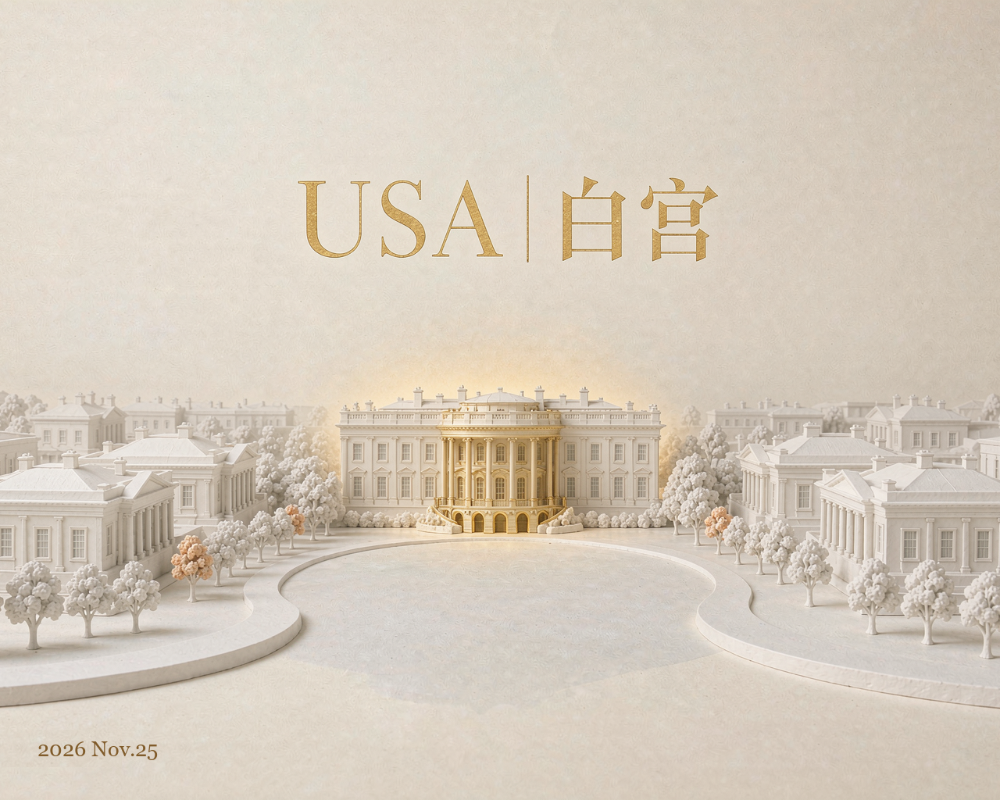 |

**反推提示词（中文）**

```text
建筑模型摄影，海报版式，5:4 横版构图，关键内容留在画宽中央八成之内。白色石膏比例的总统府建筑群与场地，从南侧上方俯视，沿主轴向北平视。完美的左右对称，严格的一点透视，所有屋脊线与车道边线交于中轴。

媒介：哑光白石膏与纸，完全漫反射，没有任何镜面高光与反射。所有形体只由屋脊折缝、墙缝、树丛之间柔和的环境光遮蔽来交代，落在一个很窄的灰阶带里。暖白无缝纸背景，细颗粒，四角轻微暗角。

画面上方四成是完全没有细节的空白纸，天空向纯白褪去。视平线在画高约 42%，远处场地化进纸里。前景的白色南草坪与弧形车道压住底边，两侧成排的小树梢带一丝极淡的暖调。

恰好只有一个元素带颜色：总统府主楼，居轴线、位于视平线略下方，做暖金箔，约占画宽百分之八，柱廊与檐口用更亮的金勾出。它周围围着一圈柔和的浅金光晕，是光晕而不是光源。其余所有结构——两翼、柱廊、附属建筑、远处偏左的古典办公楼、右侧的长柱廊建筑——一律哑光白石膏，只靠环境光遮蔽与纸面区分。

文字，全部暖金：居中于垂直轴、约画高 29% 处，一行拉开字距的细衬线大写 USA，一道细竖线，然后是衬线体的中文「白宫」，拉丁与中文视觉字号相同。画面左下角，更小更淡，同款衬线：2026 Nov.25。

全图没有黑色，除金色外没有饱和色，没有人物、车辆、旗帜，建筑上没有文字。整体读作一张连续的纸面，全幅覆一层低透明度颗粒。
```

**Prompt (English)**

```text
Architectural model photograph, poster layout, 5:4 landscape composition whose key content stays inside the central eighty percent of the frame width. A white plaster scale model of the White House complex and its grounds, seen from an elevated bird's-eye viewpoint to the south, looking north straight along the main axis. Perfect left-right symmetry, strict one-point perspective, all the roof lines and driveway edges converging on the central axis.

Medium: matte white unglazed plaster and paper, completely diffuse, no specular highlights anywhere, no reflections. All form is described only by soft ambient occlusion in the roof creases, wall joints and between the trees, in a narrow band of greys. Warm off-white seamless paper backdrop, fine grain, faint vignette at the corners.

The upper forty percent of the frame is blank paper with no detail at all, empty sky fading to pure white. The horizon line sits at about forty-two percent of the frame height, where the far grounds dissolve into the paper. In the near foreground the white South Lawn and its curved drive press against the bottom edge, with rows of small model trees along both sides tipped with the faintest warm cast.

Exactly one element carries colour: the main residence block, centred on the axis just below the horizon, rendered in warm gold leaf and occupying about eight percent of the frame width, its colonnade and cornice picked out in brighter gold. It is surrounded by a soft pale gold glow, a halo rather than a light source. Every other structure stays in plain matte white plaster, distinguished from the paper only by ambient occlusion.

Typography, all in warm gold: centred on the vertical axis at about twenty-nine percent of the frame height, the line USA in spaced thin serif capitals, a thin vertical rule, then the Chinese characters 白宫 in a serif face, both the Latin and the Chinese at the same optical size. At the very bottom left, far smaller and paler, the date in the same serif.

No black anywhere in the image, no saturated colour other than the gold, no people, no vehicles, no flags, no lettering on the buildings. Everything reads as one continuous paper surface with a low-opacity grain over the whole sheet.
```

> 成图偏差：金色主体约占 14% 画宽（参考图是 8%），视平线约 48%（参考图 42%），金色柱廊略带镜面感。这三处直接把"克制感"削弱了。

---

## 拆解方法论

### 一、先判断要复现什么

| 用户意图 | 写入提示词的内容 | 开头句式 |
|---|---|---|
| 复现整图 | 保留主体、媒介和最影响辨认的关系 | 名词性描述 |
| 借画风 / 摄影风格 | 以新主题为主体，剔除原题材的人物与情节 | 祈使句 |
| 借构图 | 画幅、占比、裁切、朝向、遮挡、留白与文字区域映射到新主体 | 祈使句 |

### 二、量化位置，别用"略偏左"

模型会把"占满画面中央略偏左"这类相对说法理解成放大，然后把贴边元素推出画幅。可行写法：

- 尺寸用画宽/画高的分数：`杯口横向直径约为画宽的五分之二`
- 边距用分数：`上沿距顶边约二十分之一画高`
- 需要完整的元素直接写 `四边完整可见`

只对贴边、出画、被遮挡、需要精确对位的主体做量化，通常一到三个。

### 三、六句序

```
1. 画幅比例与方向、媒介
2. 主体、位置与占比，以及主体之间的朝向、遮挡
3. 材质、色彩与细节分配
4. 光线方向与落点
5. 背景、留白与空气透视
6. 文字：原文、字形、断行、位置、占比
```

长度基准 150—250 字。极简画面可压到 80 字，多主体逐一定位可到 350 字。超出这个范围先怀疑是不是在堆形容词。

### 四、交稿前自查

1. 中英两句一组能对应上，英文没有多出或漏掉元素
2. 视觉锚点在开头，且是可见特征而非风格标签
3. 没有"如图所示""参考原图"这类脱离原图就失效的写法
4. 没有编造焦距、光圈、机型、软件、地名、品牌
5. 有裁切风险的元素，位置与占比已经量化
6. 长度落在区间内，形容词删到不能再删

---

## 出图之后的处理

生图通道有固定尺寸限制，落地时通常要多一步裁切：

| 目标比例 | 做法 |
|---|---|
| 16:9 | 出 1536×1024，底部裁 160px（同时切掉右下角的 AI 水印） |
| 5:4 | 出 1536×1024，左右各裁 128px（保中轴对称） |
| 3:4 | 出 1024×1536，按水印上沿决定底部裁多少，差额从顶部扣 |

裁切前一定要放大看清角落排版位置。用"亮度阈值 + 大区域扫描"定位水印，会把白色的署名字一起圈进去误涂——这个坑在本仓库的案例 2 里踩过一次。

---

## 边界与版权

- **真人**：已公开的公众人物影像只按可见外观描述，用于中性场景；不写身份推断，不生成伪造的言行或亲密、暴力、政治场景。商用需另行取得肖像授权。
- **角色与品牌**：`grand theft auto`、`VI` 字标、游戏角色形象均为他人知识产权；本仓库只做版式与方法演示，不构成授权。
- **建筑**：白宫、紫禁城等建筑形象本身通常不受著作权限制，但摄影作品受保护，生成时请使用自有素材或公开授权素材。
- **做不了就说清**：图片过小看不清关键细节、只需要转写文字、或需求本质是图像编辑而非重新生成时，说明限制，不硬凑提示词。

---

## 目录结构

```
.
├── README.md                  # 本文件（简体中文）
├── README.en.md               # English
├── LICENSE                    # 署名使用协议
├── package.json               # npm 清单，只打包 skill/
├── skill/
│   └── shuixian-image-reverse/    # 技能本体，可直接复制到 .workbuddy/skills/
│       ├── SKILL.md
│       ├── agents/openai.yaml
│       └── references/            # 4 个专项参考文件
├── assets/
│   ├── 01-gta6/               # 游戏海报换主体
│   ├── 02-city/               # 城市名片换城市
│   ├── 03-collage/            # 撕纸拼贴换人物
│   └── 04-model/              # 白模建筑换建筑
└── docs/
    ├── 01-skill-list.png        # 已安装技能列表（启停开关）
    ├── 02-skill-detail.png      # 技能详情页，概述即 SKILL.md
    ├── 03-skill-hub.png         # 技能市场里的上架卡片
    ├── reward-qr.jpg            # 赞赏码
    ├── wechat-qr.jpg            # 微信
    ├── wechat-mp-qr.jpg         # 公众号
    └── diagrams/                # 拆解结构图（SVG，可无损缩放）
        ├── city-zones.svg
        ├── collage-layers.svg
        └── model-perspective.svg
```

---

## 许可

采用**署名使用**协议（Attribution Required License v1.0）：可以自由学习、fork、安装使用、二次开发，也可用于非商业转载；但请**保留出处并链接回本仓库**，衍生项目必须写清来源，商业用途需先联系作者取得书面授权。全文见 [LICENSE](LICENSE)。

演示图分两类，权利状况不同：

| 类型 | 文件 | 权利 |
|---|---|---|
| 参考图 | `assets/*/reference.jpg` | 来自公开网络，**版权归原作者**，本项目仅作方法演示，不主张权利 |
| 生成图 | `assets/*/generated-*.png` | AI 模型产出，**不是摄影作品**，不代表任何品牌、人物或机构的官方视觉 |

图中出现的商标字形、游戏角色形象与真人肖像，权利归各自所有者，本仓库**不构成任何授权**。

## 联系

- 站点：<https://prompt.qqsrc.com/>
- 公众号：**水仙的AI提示词** —— 会经常写一些 AI 工具与提示词相关的东西
- 微信：**Kas2026** —— 公益免费交流群，不收取任何费用，喜欢技术的可以一起交流
- 问题、纠错、建议：欢迎开 [Issue](https://github.com/BaYue-SYJ/shuixian-image-reverse/issues)

| 赞赏码 | 微信 | 公众号 |
|:---:|:---:|:---:|
|  |  |  |

## 致谢

| 社区 | 说明 |
| --- | --- |
| [Linux.Do](https://linux.do) | 与社区分享、讨论和跟踪发展 —— 认可 LINUX DO 社区 |

---

<p align="center"><sub>Made with the <code>shuixian-image-reverse</code> skill in WorkBuddy</sub></p>
